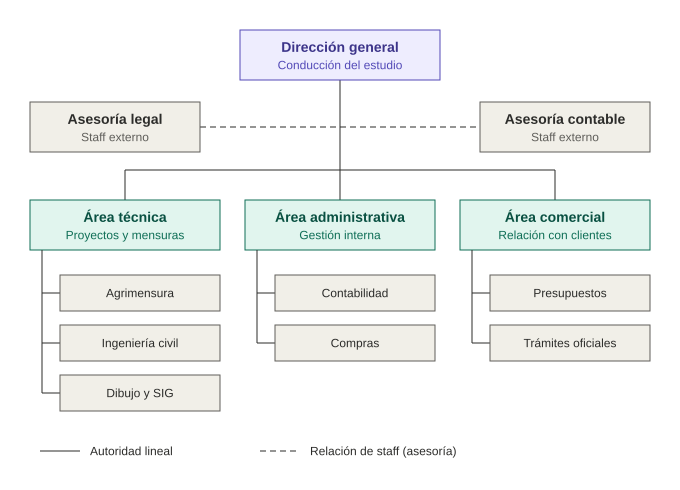

# Estructura formal: organigrama

## Organigrama piramidal vertical

El organigrama representa la estructura jerárquica formal del estudio, con las siguientes convenciones de las ciencias de la administración:

- **Rectángulos** para cada unidad organizacional.
- **Líneas continuas** para la autoridad formal (línea de mando).
- **Líneas de trazos** para las relaciones de staff, es decir, de asesoría sin autoridad sobre las áreas.

## Niveles jerárquicos

1. **Dirección general:** conduce el estudio y toma las decisiones estratégicas.
2. **Áreas funcionales:** técnica, administrativa y comercial.
3. **Departamentos:** unidades dependientes de cada área.

| Área | Departamentos |
|---|---|
| Técnica | Agrimensura, Ingeniería civil, Dibujo y SIG |
| Administrativa | Contabilidad, Compras |
| Comercial | Presupuestos, Trámites oficiales |

Las asesorías legal y contable son órganos de **staff externo**: asesoran a la Dirección general sin tener autoridad sobre las áreas.

## Asignación de funciones

El organigrama representa **puestos y unidades**, no personas. Por tratarse de una empresa familiar, algunas personas cubren más de un puesto y más de un área. El siguiente cuadro aclara quién ocupa cada puesto con sus tareas.

| Persona | Puestos que ocupa |
|---|---|
| Guillermo Sancholuz (ingeniero civil) | Dirección general, Área técnica, Ingeniería civil, Área comercial, Presupuestos |
| María Delia Marina (gestora) | Dirección general, Dibujo y SIG, Área administrativa, Contabilidad, Compras, Trámites oficiales |
| Nicolás Sancholuz | Agrimensura, Dibujo y SIG, Área administrativa, Contabilidad |
| Abogado/a externo/a | Asesoría legal (staff) |
| Contador/a externo/a | Asesoría contable (staff) |

