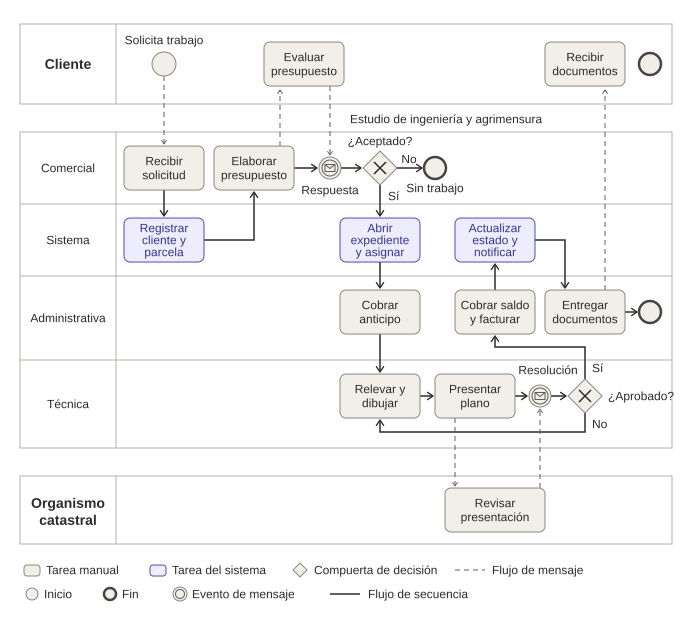

# Modelado de procesos de negocio (BPMN)

## Proceso modelado

Ciclo completo de un expediente de mensura, desde que el cliente solicita el trabajo hasta que se le entrega la documentación. Es el proceso que el sistema va a automatizar en parte.

## Pools y lanes

**Pools** (organizaciones y actores externos):

| Pool | Descripción |
|---|---|
| Cliente | Persona o empresa que solicita el trabajo. Actor externo, sin lanes |
| Estudio de ingeniería y agrimensura | Organización que ejecuta el proceso. Tiene cuatro lanes |
| Organismo catastral | Ente externo que revisa y resuelve sobre los planos. Sin lanes |

**Lanes del pool Estudio** (roles internos y comportamiento automatizado del sistema):

| Lane | Responsabilidad |
|---|---|
| Comercial | Recibe la solicitud y elabora el presupuesto |
| Sistema | Ejecuta las tareas automáticas: registrar cliente y parcela, abrir el expediente, actualizar estado y notificar |
| Administrativa | Cobra el anticipo y el saldo, factura y entrega los documentos |
| Técnica | Releva, dibuja y presenta el plano ante el organismo |

Los pools se comunican mediante **flujos de mensaje** (líneas punteadas). Dentro de un pool, las actividades se conectan con **flujos de secuencia** (líneas continuas), incluso cuando cruzan de un lane a otro.

## Flujo estándar

1. **Solicitud.** El cliente solicita el trabajo y Comercial recibe la solicitud.
2. **Registro.** El sistema registra automáticamente al cliente y la parcela.
3. **Presupuesto.** Comercial elabora el presupuesto y se lo envía al cliente, que lo evalúa y responde.
4. **Apertura del expediente.** Si el cliente acepta, el sistema abre el expediente y asigna un responsable.
5. **Anticipo.** Administrativa cobra el anticipo.
6. **Relevamiento y dibujo.** El área técnica releva el terreno y dibuja el plano.
7. **Presentación.** Técnica presenta el plano ante el organismo catastral, que lo revisa y emite una resolución.
8. **Cobro del saldo.** Con el plano aprobado, Administrativa cobra el saldo y factura.
9. **Actualización.** El sistema actualiza el estado del expediente y notifica al cliente.
10. **Entrega.** Administrativa entrega los documentos al cliente y el expediente queda cerrado.

## Excepciones (compuertas de decisión)

| Compuerta | Camino alternativo |
|---|---|
| ¿Aceptado? | Si el cliente rechaza el presupuesto, el proceso termina en "Sin trabajo" y no se abre el expediente |
| ¿Aprobado? | Si el organismo observa el plano, el flujo vuelve al área técnica para corregirlo y presentarlo de nuevo. El ciclo se repite hasta que el plano se aprueba |

## Tareas automatizadas por el sistema

| Tarea | Entidades y campos involucrados |
|---|---|
| Registrar cliente y parcela | Crea registros en CLIENTE y PARCELA |
| Abrir expediente y asignar | Crea el registro en EXPEDIENTE, con `id_cliente`, `id_parcela` e `id_personal` |
| Actualizar estado y notificar | Modifica `estado` en EXPEDIENTE y envía la notificación al `email` del cliente |

## Coherencia con el diccionario de datos

- Las tareas de cobro se reflejan en los campos `anticipo`, `anticipo_cobrado` y `saldo_cobrado` de EXPEDIENTE.
- El ciclo de corrección ante observaciones del organismo se refleja en el valor "observado" del campo `estado`.
- Las compuertas de decisión se registran en el sistema como cambios de `estado`.

Ver [diccionario de datos](02-diccionario-de-datos.md).
